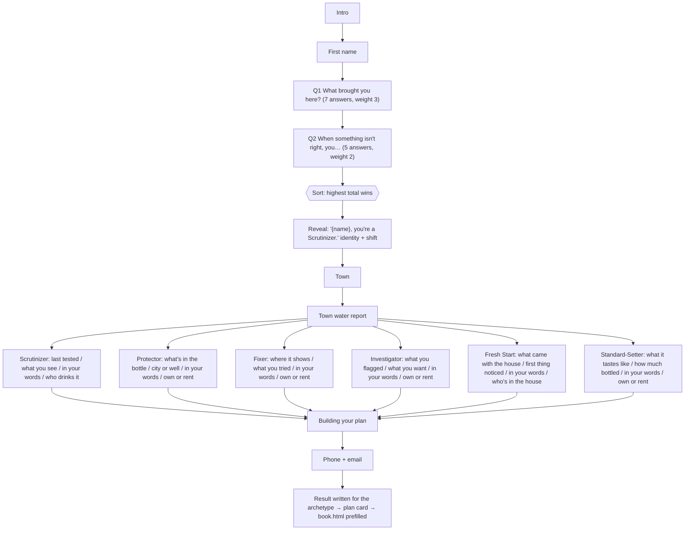

# Clear — website

Homepage for Clear, a Connecticut water testing and filtration company. Plain HTML, CSS and JavaScript — no build step, no framework, no dependencies.

## Open it in Cursor

1. Unzip `clear-website.zip`.
2. In Cursor: **File → Open Folder…** and pick the `clear-website` folder.
3. To preview, either:
   - double-click `index.html` to open it in your browser, or
   - in Cursor's terminal run `npx serve .` (or `python3 -m http.server`) and open the address it prints.

Everything works offline except the Google Fonts, which load from the internet.

## What's in here

| File | What it is |
|---|---|
| `index.html` | The whole page: hero, water map, filtration, pricing, booking form, CTA, footer |
| `styles.css` | Brand colors, type, animations, and the phone layout (everything under 720px wide) |
| `app.js` | Mobile menu, town map (click, hover, zoom), address check, filtration cards, booking form |
| `assets/sky.jpg` | Hero sky photo (animated with CSS) |
| `data/ct-towns-map.js` | The 169 town shapes (pre-projected for the SVG map) + water profile for each town |
| `data/ct-towns.geojson` | Same towns as real lat/lng GeoJSON with water-profile properties — use this for Mapbox |
| `data/ct-water-towns.json` | Full town dataset: population, public water systems, sources and method notes |

## Run it locally (phone + desktop)

```bash
npm install        # once
npm run dev        # serves the folder at http://localhost:3000
```

No Node? `python3 -m http.server 3000` from this folder does the same job.

To open it on your phone: make sure the phone is on the same Wi-Fi, find the computer's LAN address (`ipconfig getifaddr en0` on a Mac, `ipconfig` on Windows), and visit `http://<that-address>:3000/start.html` on the phone. Chrome DevTools device mode (Cmd/Ctrl+Shift+M, pick "iPhone") is the quick alternative.

## The water check (`start.html`)

A mobile-first intake quiz modeled on the Hims & Hers "assessment" funnel, built around **identity archetypes**: two questions sort the visitor into one of six types, the quiz names the type back to them (the identity shift), then asks that type's own follow-ups in its own voice, shows the town's real water data, captures contact, and writes the recommendation *for that type*. The product is framed as what someone like them does, not as a pitch.

| File | What it is |
|---|---|
| `archetypes.md` | The six archetypes: identity, the shift line, voice, pain points, product lean. **Read this first.** |
| `quiz_map.json` | Every question, answer, branch, archetype weight and tag, plus the archetype copy and the plan cards. All copy lives here; edit it without touching code. |
| `quiz.js` | The engine: loads the map, runs the sort, renders each screen, builds the recommendation from the archetype + tags, hands off to `book.html`. |
| `quiz.css` | Scoped under `.sq` so it can't restyle the rest of the site. Also holds the phone sticky bar on the home page. |
| `start.html` | The page. Loads `quiz.css` + `quiz.js` and the town water data. |

**The map:**



**Archetypes and leans:** `scrutinizer` → test first · `protector` → kitchen-tap RO · `fixer` → Soft · `investigator` → test first (a measurement, not a pitch) · `freshstart` → test first (a baseline) · `standard` → Essential. Branch answers carry tags (`hard`, `health`, `taste`, `sed`, `well`, `rent`, `softener`, …) that can override the lean; renters always get the kitchen tap. The rules are `recommend()` in `quiz.js`.

**Entry points:** hero address bar on the home page, the "Find my system" buttons, a phone-only sticky bar that slides up once the hero scrolls away, and on phones a bottom-sheet invitation that appears once per visit (after 6 seconds or once the hero scrolls away) and can be dismissed. Phones see the normal home page; nobody is forced into the funnel. Deep links: `start.html#address=...`, `start.html#town=Guilford`, `start.html#source=well`, add `&restart=1` to clear a saved session. Hashes, not `?query=`, because Vercel's `cleanUrls` redirect drops a query string.

**Leads:** every finished quiz is stored in the browser under `localStorage["sunday_quiz_leads"]` with the archetype, every answer, the open-text answers (`in_their_words`), the tags and the recommendation. To send them somewhere real, set `window.SUNDAY_LEAD_ENDPOINT` in `start.html` to a Formspree, Zapier catch-hook, Supabase or CRM URL; the quiz POSTs one JSON object per lead. The booking form on `book.html` also receives the answers in the URL hash plus hidden `quiz_plan` and `quiz_archetype` fields.

**Editing copy:** change `quiz_map.json`. `*word*` renders in the script face; `{name}` and `{town}` are replaced. Keep the `tags` and `w` (weights) on each answer; the engine reads them. Add an archetype by adding it to `archetypes` and giving it a `branches` entry and at least one opener answer that weights toward it.

## The drop animation (home page, "Follow a drop through your home")

The filtration section is a layered, scroll-driven scene on a `<canvas>`: a cutaway plate with no characters, plus a sprite atlas of Drip and the four contaminants (rust, chlorine, scale, dissolved solids; four poses each). `app.js` fires `sunday:stage` with the pinned progress (0–1); `drop.js` moves Drip along the pipe path, has each villain caught at its tank in step with the four stage cards, dims the stages not in play, fills the glass from the RO tap, and ends with Drip cheering.

| File | What it is |
|---|---|
| `drop.js` | The renderer. Path points, zones, catch timings and sprite sizes are the constants at the top. |
| `assets/drop/plate.webp` / `plate.jpg` | The cutaway (1344×576). The jpg is also the poster shown until the canvas is ready. |
| `assets/drop/atlas.webp` / `atlas.png` | Sprite atlas; `frames.json` has the rects (also inlined in `drop.js`). |
| `assets/drop/build_atlas.py` | Rebuilds plate + atlas from `assets/drop/src/` (python3 + Pillow). `src/` is gitignored. |

Beat map: 0–0.25 Sediment (rust caught at tank 1) · 0.25–0.50 Carbon (chlorine absorbed at tank 2) · 0.50–0.75 Softener (scale caught, dropped in the brine tank) · 0.75–1.00 RO (dissolved solids stopped at the membrane; glass fills; Drip celebrates). Phones fit the plate's height and pan with Drip. Reduced-motion and headless capture get the final scene.

## Brand

See `DESIGN.md` for the full brief.

- Seafoam `#8FC9B5` (brand / paint) · Cream `#F3EDDC` (paper) · Black-teal `#0E2E2C` (ink) · Brick `#B6432F` (accent / CTA)
- Deep seafoam `#3E8F74` for labels and script accents on cream; cards a shade lighter at `#FAF6EA`
- Map: public system `#A9D4C4` · small systems only `#E4C56A` · likely private wells `#E07A62`
- Type: **Archivo** condensed (75%) 800 caps for headlines, Archivo for body and labels; **Playball** script for one accent word per headline

## Before going live — fill these in

Search the project for `[` to find every placeholder:

- `[Phone]` — nav, mobile menu, footer (make the nav one a `tel:` link)
- `[Email]` — footer
- `$[X,XXX]` and `$[XX]/mo` — the three plan prices
- `[Financing terms…]` — lender disclosure under pricing
- `HIC.[0000000]` — your CT Home Improvement Contractor registration number (CT requires it on advertising)

## Next steps (good prompts to give Cursor)

- **Make the booking form send leads:** "Wire the booking form in app.js to Formspree / HubSpot / my CRM's API, with a loading state and an error message." (Look for the `TODO` in `app.js`.)
- **Swap in a real Mapbox map:** "Replace the SVG map with Mapbox GL JS. Load `data/ct-towns.geojson` as a fill layer colored by `water_profile` (major_system #A8C4FF, small_systems_only #FFD978, no_public_system #FF8F66), keep the town panel behavior, and zoom to the town that's picked." You'll need a Mapbox access token.
- **Real address lookup:** "Geocode the hero address with the Mapbox Geocoding API instead of matching town names in the text."
- **Move to a framework:** "Convert this site to Next.js + Tailwind, keeping the design identical."
- **Hosting:** the folder can be dropped as-is onto Netlify, Vercel or Cloudflare Pages.

## Data notes

- Town water profiles come from EPA's Safe Drinking Water Information System (community water systems serving 1,000+ people and the towns each one lists).
- EPA lists which towns a system serves, not how much of each town — so "public system present" does **not** mean every home in that town is on public water. The site copy already says this; keep it that way.
- Town boundaries: U.S. Census Bureau 2019 cartographic boundary file (county subdivisions).
- Statewide well figure ("1 in 4"): CT Private Well Records report, September 2020 (~23% of residents).
